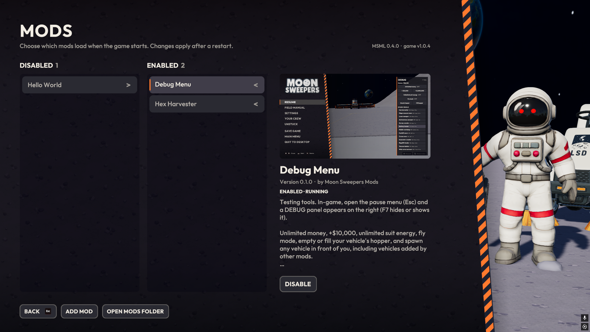

# MSML: Moon Sweepers Mod Loader



## Install, update or uninstall

> [!CAUTION]
> DO NOT TRUST RANDOM SCRIPTS ON THE INTERNET! While I know there is nothing nefarious here, you DON'T! Please do your due diligence and review any scripts before running them on your machine.

Close Moon Sweepers, open PowerShell, and paste:

```powershell
irm https://github.com/Wehrum/MSML/releases/latest/download/get.ps1 | iex
```

> [!WARNING]
> MSML and its mods are unofficial, experimental and only lightly tested. They aren't made or supported by the developers of Moon Sweepers. They could crash the game, corrupt your saves or your moon, or stop working after a game update. **Back up your saves** (`%USERPROFILE%\AppData\LocalLow\DragDropGames\MoonSweepers`) before using them. You use MSML and any mods at your own risk; we aren't responsible for lost or damaged saves.

### Adding mods

MSML doesn't include any mods. Ready-made ones are in [`mods/`](mods). To add one:
- Download the mod's `.zip` (from [`mods/`](mods) or anywhere else)
- In the main menu choose `MODS > ADD MOD`
- Select the mod

Or you can extract it into `<game>\Mods\`. Restart the game to load it.

**Updates:** the MODS screen checks for updates when you open it (or with **CHECK FOR UPDATES**). Mods with a newer version get an **UPDATE** button (or **UPDATE ALL MODS**); the new version loads after a restart. When MSML itself has a new release, **UPDATE MSML** closes the game, runs the installer in a PowerShell window and starts the game again. The install command above still works too.

### Official mods

| Mod | Description | |
|---|---|---|
| **MoonSweeper+** | Quality-of-life fixes, each with its own setting. So far: the vehicle camera stays where you point it instead of snapping back behind the vehicle (auto recenter can be turned back on, with your own delay). | [`mods/`](mods) |
| **Hex Harvester** | A new vehicle, sold in the garage for $100,000: a six-wheeled harvester with a 25 m sweeper head that clears a whole hex in one pass, and a glass silo (9,000 kg) that visibly fills with dust. Its price and upgrade prices are adjustable in SETTINGS. It's delivered in front of the garage, since it doesn't fit in the hall. | [`mods/`](mods) |
| **MoonFixerUpper** | Fixes for bugs in the game itself. So far: "Could not pack a capsule", where reaching the moon's 10,000-capsule limit (capsules on belts count) freezes every stone press and pressure chamber and backs up all belts for good. Works on existing saves; only the host needs it. | [`mods/`](mods) |
| **Better Belts** | Pneumatic tubes: glass tubes sunk into the ground, built like belts (up to 90 m), that shoot capsules along up to 5x as fast (10x in SETTINGS). A Tube booster running on solar power like a machine pressurises the tubes after it (through splitters and mergers) for about 80 m, then the pressure fades; rings on the tubes show it (green full, yellow fading, red belt speed). Tubes connect to belts, splitters, mergers and machines; the Tube splitter and Tube merger are sunk into the ground too, so tube lines join them flush. Tubes follow the ground over bumps and down hills, can be walked and driven over, never stop (no air only means belt speed), and become plain belts if the mod is removed. Speed, ranges, prices, power and a colour-blind palette are in SETTINGS. | [`mods/`](mods) |

Mod settings can be changed in the MODS screen (select the mod, then **SETTINGS**) and, for mods that support it, in the pause menu under **MOD SETTINGS**.

Modded vehicles and belt types are saved so that removing the mod never breaks a save: a bought Hex Harvester just disappears until the mod is back, and tubes become plain belts.

**Multiplayer:** everyone in a crew needs the same vehicle and belt mods. A host with them shows up as e.g. version `1.0.4 + mods: Hex Harvester`, and players without the same ones are turned away with a message saying which mods to add or turn off (players without MSML see the game's own "That crew plays version 1.0.4 + mods: Hex Harvester" message). Players with matching mods join normally and use the host's garage prices. Joining an unmodded crew with mods works too; mod vehicles just aren't sold there.

### Example mods

| Mod | Version | Description | |
|---|---|---|---|
| **Debug Menu** | 0.1.0 | Testing tools. In-game, open the pause menu (Esc) and a DEBUG panel appears on the right (F7 hides or shows it). | [Download](https://github.com/Wehrum/MSML/raw/main/mods/DebugMenu-0.1.0.zip) |
| **Hello World** | 0.1.0 | A tiny example mod. It shows a "Hello World mod loaded" label in the top-left corner for 30 seconds after the game starts, and logs a message whenever the main menu opens. | [Download](https://github.com/Wehrum/MSML/raw/main/mods/HelloWorld-0.1.0.zip) |

### Creating a mod

1. Copy `examples/HelloWorld` to `examples/<YourMod>` (or anywhere in the repo). Rename the `.csproj`, and change
   `AssemblyName` and the plugin `Guid`/`Name`.
2. Edit `package/mod.json` and replace `package/preview.png`. Everything in `package/` ships next to the DLL.
3. `dotnet sln add examples/<YourMod>/<YourMod>.csproj`, then `dotnet build -c Release`.
4. In the game, open MODS, enable it, and restart.

A mod is a BepInEx 6 IL2CPP plugin (`BasePlugin` with `[BepInPlugin]`). Its folder in `Mods\` can contain:

```text
Mods\YourMod\
  YourMod.dll        one or more DLLs (BepInEx finds plugins in any of them)
  mod.json           optional: name, version, author, description, preview, website, id
  preview.png        optional: picture shown in the Mods screen (16:9 looks best; preview.jpg / icon.png also work)
```

```json
{
  "name": "Your Mod",
  "version": "1.0.0",
  "author": "You",
  "description": "What it does. Newlines (\\n) are kept.",
  "updates": "https://example.com/your-mod/index.json"
}
```

Without `mod.json`, the name and version come from the `[BepInPlugin]` attribute.

`updates` (optional) lets players update your mod from the MODS screen: a link to a JSON file listing your mod's latest version, `{ "mods": [ { "id": "yourmod.id", "version": "1.1.0", "url": "https://.../YourMod-1.1.0.zip", "sha256": "..." } ] }` (`id` matches your mod.json's `id`; `sha256` is optional but recommended). Official mods are checked through [`mods/index.json`](mods/index.json), which `tools/build-mods.ps1 -Sync` writes.

### Mod settings (MSML API)

Declare settings the normal BepInEx way. Every loaded mod's settings show up in the MODS screen (select the mod, then SETTINGS) with no extra code: OFF / ON for `bool`, - / + for numbers (bounded by an `AcceptableValueRange`), and a choice per option for enums and `AcceptableValueList`. Changes save to the mod's `.cfg` straight away and raise `SettingChanged`.

To use the API, add `<UseMsmlApi>true</UseMsmlApi>` to the `.csproj`. `MSML.Api.dll` ships with the loader, so it's never copied into your mod. With it you can:

```csharp
using MSML;

public override void Load()
{
    _delay = Config.Bind("Camera", "RecenterDelay", 5f, new ConfigDescription(
        "Seconds before the camera swings back.",
        new AcceptableValueRange<float>(1.2f, 30f),
        ModSettings.Step(0.5)));                   // - / + change it by 0.5
    Config.Bind("Debug", "Internal", 0, new ConfigDescription("Not for players.", null, ModSettings.Hidden));

    ModSettings.ShowInGame(this);                  // also list them in the pause menu (MOD SETTINGS)
}
```

Only use `ShowInGame` for settings that take effect immediately. [`official/MoonSweeperPlus`](official/MoonSweeperPlus) is a complete example.

### New vehicles (MSML API)

`Vehicles.Register` adds a vehicle to the game's catalog. It runs on the game's own vehicle code (driving, cleaning, hopper, unloading, lights, sounds), built on a stock base vehicle whose prefab, physics anchors and sounds it uses. Give it a price and it's sold in the garage, with your picture on its card:

```csharp
Vehicles.Register(new ModVehicle("yourmod.bigsweeper", "Big sweeper", MoonPrototypeCatalog.MegaVacuumRover)
{
    CleaningWidth = 8f,          // metres (defaults are the base vehicle's)
    HopperKg = 5000,
    Price = 12000,               // sold in the garage; null = not sold
    Summary = "One line for the garage card.",
    Icon = "garage.png",         // 512x512 PNG with a transparent background, next to your DLL
    BuildModel = (model, kit) => { /* change or replace the base vehicle's model */ },
});
```

Bought modded vehicles are saved by id in records the unmodded game ignores, so saves never break when a mod is removed. Also available: `Heft`, `Speed`, `Turn`, `Cargo`, `UpgradePriceScale` (the garage's upgrade prices are each upgrade's base price times this; the Mega Vacuum Rover's is 3) and `UpgradePrices` (exact prices per upgrade and level), `Ready` (called when one is set up in the world), `Update` (called every frame, e.g. to show the hopper level), `HideDriver` (for closed cabs) and `DeliverOutsideGarage` (for vehicles too big for the garage hall). Price, summary and upgrade prices can be changed while the game runs. In multiplayer the API handles the rest: it advertises your vehicles in the crew lobby so only players with the same vehicle mods can join, uses the host's prices on crewmates' garages, skips vehicles a player doesn't have instead of crashing, and runs `RemoteUpdate` (and `HideDriver`) for crewmates' copies of your vehicle. [`official/HexHarvester`](official/HexHarvester) is a complete example, and [`tools/scripts/render-icon.cs`](tools/scripts/render-icon.cs) renders a garage picture from the in-game model.

### New belts (MSML API)

`Belts.Register` adds a belt type with its own card in the build menu (Logistics). Choosing the card builds with the game's own belt tool, so belts of the type connect to belts, splitters, mergers and machines like any belt; the type adds a speed, a price and a look. Removing the mod turns them back into plain belts.

```csharp
var tube = Belts.Register(new BeltType("yourmod.tube", "Fast tube")
{
    Description = "Text for the card's details.",
    Card = "tube.png",           // 512x512 PNG with a transparent background, next to your DLL
    Speed = 2f,                  // compared to a plain belt (1.1 m/s)
    PriceScale = 4,              // or PricePerPiece = 250 for a fixed price
    MaxLength = 3f,              // optional: longest piece in metres
    Style = (belt, parts) =>     // add your parts under 'parts' whenever the belt gets a view
    {
        var glass = BeltLooks.Tube(belt, parts.transform, radius: 0.5f, lift: 0.22f);
        if (glass != null) BeltLooks.Show(parts.transform, "Glass", glass, BeltLooks.Glass(new Color(0.6f, 0.85f, 1f, 0.3f)));
    },
});
```

Options for belts that look nothing like belts: `HideBelt` (the game's belt isn't drawn, nor its build/removal animations; the red removal highlight and dismantle effect use your parts), `Preview` (the placement hologram), `RiderPose` (how capsules on it are drawn, near and far), `OnGround` (only along the ground; `MaxGroundGap` / `MaxGroundRise` say how far above it, or cut into a hump, it may go: `BeltLooks.GroundProfile(path, step, maxDrop, maxRise)` gives the ground's height along it so your look can follow it), `PassThrough` / `ColliderTop` (walk and drive over it), `FixedLength`, `NoChaining` and `DeleteRidersOnRemove`. `Belts.Riders` lists the capsules on a belt.
 speeds also work per belt (`Belts.SetSpeed`, including the routes inside splitters and mergers from `Belts.RoutesThrough`), and the network can be followed with `Belts.Downstream` / `Upstream` (through splitters and mergers, also ones joined straight to each other: `Belts.JunctionsAfter` lists them), `EndsAt` / `StartsAt`, `PathOf` and `OfType`; `Belts.Changed` says when to look again. Speeds apply everywhere on the moon, however far away. Types are saved with the moon and kept in step in a crew (the host's table wins), and belt types count as crew content like vehicles. `BeltLooks` has meshes that follow a belt's path, glass and glowing materials, and the game's own conveyor materials. [`official/BetterBelts`](official/BetterBelts) is a complete example, and [`tools/scripts/tube-cards.cs`](tools/scripts/tube-cards.cs) renders its card pictures.

`Junctions.Register` does the same for splitters and mergers: a `JunctionType` (`JunctionType.Splitter` or `Merger` to the game) gets its own card, and the ones built with it keep the type (saved, and in step in a crew). Options: `HideModel` and `Style` (draw your own look; `Junctions.Pose` says where it stands, `Junctions.InputsOf` / `OutputsOf` where its ports are), `Preview` (the placement hologram, in the structure's own space), `RouteType` (capsules passing through are drawn by that belt type's `RiderPose`), `PortSink` (its mouths are drawn lower than the game's ports, e.g. sunk into the ground: aiming a belt at a mouth snaps to its port, and the port markers show there) and `PassThrough` / `ColliderTop`. `BeltLooks.SceneMaterial` finds any loaded material (e.g. "MoonRock") and `BeltLooks.WorldMesh` turns world-space points into a mesh. Better Belts' tube splitter and merger use it; [`tools/scripts/junction-cards.cs`](tools/scripts/junction-cards.cs) renders their cards.

The build menu (`BuildMenu`) is shared by all of these: a mod's card is highlighted while it's the one being built or hovered (even though the game builds the belt, splitter or merger it stands in for), and a card can go in a sub-tab of its tab with the type's `Section` (or `BuildMenu.SetSection(kind, "Tubes")`). A tab with sections gets a row of sub-tabs: ALL, STANDARD (the game's own cards) and one per section.

**Performance:** every Unity call a mod makes, including maths like `Vector3 +`, `Mathf.Lerp` or `transform.position`, crosses into the game (~80 ns) and leaves ~32 bytes of garbage on the game's heap; enough of them every frame makes the game stop for collections (frame drops). In code that runs every frame or per vertex, use `VMath` (plain C# vector maths), cache what doesn't change, and fill meshes from arrays (`mesh.vertices = array`) rather than lists. [`tools/scripts/perf.cs`](tools/scripts/perf.cs) profiles a running game.

### More API

- **`MoonData`**: small per-moon data saved inside the moon's save (`MoonData.Set("yourmod.key", json)`, `Get`, `Loaded` event). It travels with the moon to crewmates, and the unmodded game keeps it.
- **`CrewMessages`**: messages between mods on crewmates' machines, on a Steam channel of their own (`On(topic, handler)`, `Send`, `SendToCrew`, `SendToHost`, `IsHost`, `Crewmates()`). The host gets `CrewmateReady` when a crewmate has loaded the moon, to send them its state straight away; name belts in messages by their ends (`Belts.EndsOf` / `Belts.FindByEnds`), since belt ids differ between machines.
- **`Moon`**: `Moon.World`, `Moon.Update` (every frame on a moon) and `Moon.Find<T>()` (Unity's `FindObjectOfType` is stripped from the game).
- **`Power`**: `Power.Add(position, kW)` runs something on the solar grid like a machine: it joins the nearest panel's grid, counts as one of its machines, draws spare solar power then the batteries, shows the blue power beam, and reports how much power it got.
- **`GameSounds`** (the game's own clips, played in the world) and **`Puffs`** (soft streams of air, steam or dust).

### Testing without restarting

[`tools\cs.ps1`](tools/cs.ps1) runs C# inside the running game (compiled on the fly), so you can poke at game code, spawn and drive vehicles, or try a Harmony patch in seconds. See [`tools/scripts`](tools/scripts).

### Making models

Models are code, built with [`shared/ModelKit`](shared/ModelKit) (boxes, tapered blocks, prisms and hex columns, cylinders, rods, spheres, radial patterns), for example [`HexHarvesterDesign.cs`](official/HexHarvester/Design/HexHarvesterDesign.cs). The same design renders in the game, through `UnityModelBuilder`, and offline without the game:

```powershell
.\tools\preview-model.ps1 HexHarvester                                   # artifacts\previews\HexHarvester.png, 6 views, about 1 s
.\tools\preview-model.ps1 HexHarvester -View "front 3/4" -Size 1280x720  # one clean view, for example a mod's preview.png
```

The previewer culls back faces like Unity does, draws a 1 m/5 m ground grid with the cleaning width marked in orange, and adds shadows and part outlines. Put designs in `official/<Mod>/Design/*.cs` or `examples/<Mod>/Design/*.cs`, implementing `IModelDesign`, and the previewer picks them up automatically.

## Licensing notes

`tools/il2cppinterop/Class_108_0.cs` is derived from [Il2CppInterop](https://github.com/BepInEx/Il2CppInterop),
which is LGPL-3.0, and the file stays under that license.
